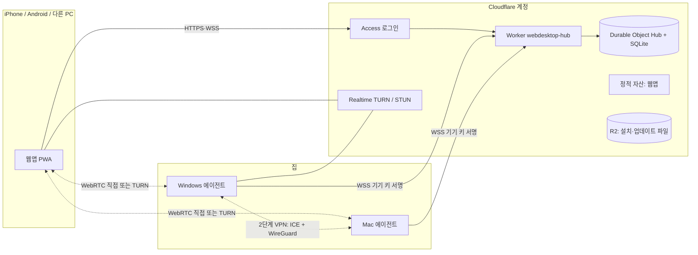
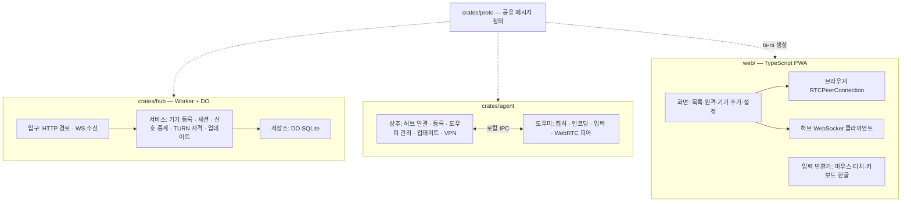
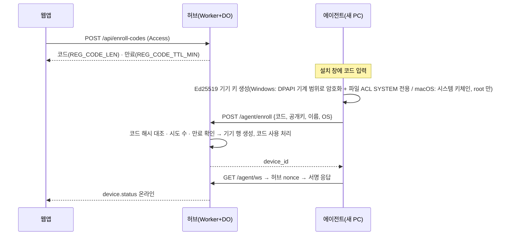
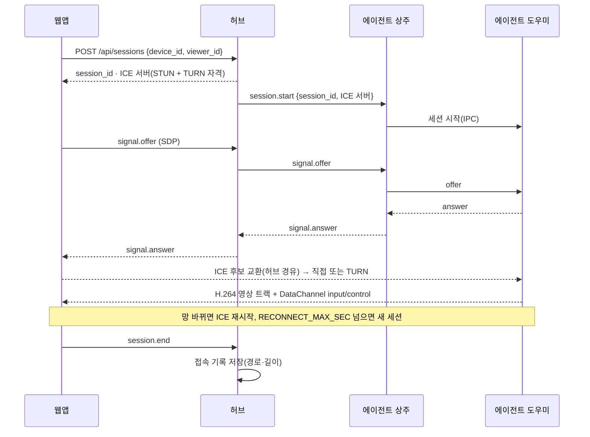
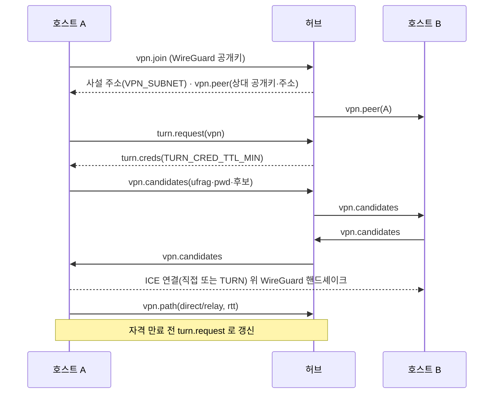
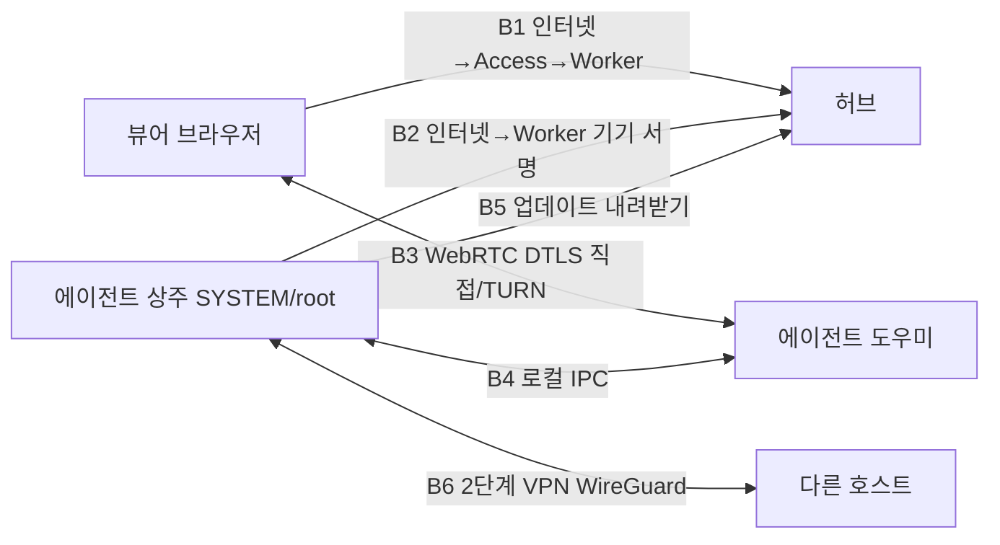

# 아키텍처 — WebDesktop
버전: v1.2 · 기준 03 v1.2 · 개정: GATE 1차(TURN 클라이언트·VPN 계약·키 보호·업데이트 경로·유지 신호)

근거 (진입 사전조사)
- 정량: Cloudflare TURN 월 1,000GB 포함, STUN 무료 — https://www.cloudflare.com/products/turn-sfu/ (2026-11-23). 이 PC → Tailscale 도쿄 중계 39.5ms(local-inspection T3).
- 정성: "a self-hosted rendezvous_server is accepted … then silently replaced by the fastest public server" — https://github.com/rustdesk/rustdesk/issues/15861 → 연결 경로를 숨기지 않고 화면에 보인다.
- 사용자 영향: 기기 목록에서 누르면 바로 화면, 경로(직접/중계)와 권한 문제가 목록에 보인다.

## Context & Scope
- 사용자 1명. 호스트 = Windows PC·MacBook. 뷰어 = 같은 웹앱(iPhone Safari, Android Chrome, PC 브라우저).
- 서버 = 기존 Cloudflare 계정(Workers Paid — DL-6): Worker 1개 + Durable Object 1개 + 정적 웹앱 + Realtime TURN + Access.
- 네이티브 코드는 호스트 에이전트뿐. 폰 앱 없음.

## Goals / Non-goals
- Goals: 03 G1·G2·G3. 1단계 = 원격 화면(FR-001~017), 2단계 = VPN 메시(FR-018).
- Non-goals: 03 「범위 밖」 전부.

## 설계

### 시스템 컨텍스트

### 구현 접근 — 난점과 선택
| 난점 | 선택 | 근거 |
|---|---|---|
| 브라우저가 직접 연결·중계를 쓰려면 | WebRTC. 에이전트는 `str0m`(MIT, Sans-IO — H.264 프레임 쓰기·대역폭 추정 지원, README 「Frame level」). 중계는 TURN 만(브라우저 제약 — B1). **str0m 은 TURN 할당을 하지 않음**(README 「NIC enumeration and TURN」). 결정(DL-9): **1단계 에이전트는 TURN 클라이언트 없음** — 뷰어 브라우저가 TURN 중계 주소를 만들고 에이전트는 그 주소로 UDP 를 보낸다(집 망 UDP 가능 — local-inspection T2). 에이전트 TURN 클라이언트(crates.io `turn` 또는 RFC 8656 할당 직접 — 03 가정 T1)는 2단계 VPN 에서 넣는다 | research/remote-desktop-oss.md, str0m README |
| 신호·기기 목록·온라인 표시 | Worker + Durable Object 1개(이름 `owner`). 모든 WebSocket 이 이 DO 에 붙는다. 휴면 API + `ping`→`pong` 자동 응답(AGENT_HEARTBEAT_SEC)으로 대기 중 DO 를 깨우지 않음. 오프라인 판정: WebSocket 닫힘 이벤트, 또는 마지막 자동 응답·앱 메시지 시각이 OFFLINE_DETECT_SEC 보다 오래됨(뷰어가 목록을 열 때 검사). 자동 응답 시각 조회 API 가 workers-rs 에 있는지 검증 필요 — 확인 방법: `worker/src/durable.rs` 에서 auto response timestamp 함수 찾기. 없으면 에이전트가 OFFLINE_DETECT_SEC 의 절반마다 앱 메시지 `agent.alive` 를 보냄(DO 가 깸 — 비용 작음, 1인) | Cloudflare DO WebSocket 문서 https://developers.cloudflare.com/durable-objects/best-practices/websockets |
| Worker 언어 | Rust(`worker` 크레이트 v0.9.0, wasm). 휴면 API·SQLite·자동 응답 있음(확인: github cloudflare/workers-rs `worker/src/durable.rs`). 24시간 연결은 검증 필요 — 확인 방법: 03 가정 H1 시험. 안 되면 허브만 TypeScript | 사용자 요청 「Rust 기반」 |
| 로그인 | Cloudflare Access 이메일 PIN(DL-4). Worker 는 `Cf-Access-Jwt-Assertion` 을 Access 공개키로 검증 | https://developers.cloudflare.com/cloudflare-one/identity/one-time-pin/ |
| TURN 자격 | Worker 가 Cloudflare TURN 키(비밀)로 세션마다 짧은 자격(TURN_CRED_TTL_MIN) 발급. **검증 필요** — 확인 방법: Cloudflare Realtime TURN 문서의 자격 발급 API 경로 확인 | https://developers.cloudflare.com/realtime/turn/ |
| Windows 캡처(잠금·UAC 포함) | DXGI Desktop Duplication. 서비스(SYSTEM, 세션 0)가 콘솔 세션에 SYSTEM 토큰으로 도우미를 띄움. 도우미가 입력 데스크톱(Default↔Winlogon) 전환을 감지해 다시 붙음. 입력 `SendInput`(보안 데스크톱은 SYSTEM 도우미에서), Ctrl+Alt+Del 은 `SendSAS` | 사전 부검 P2, B11 |
| macOS 캡처 | LaunchDaemon(root) + LaunchAgent(사용자 세션). 로그인 창용 LaunchAgent(FR-014)는 검증 필요 — 확인 방법: 03 가정 M1 spike. 캡처 ScreenCaptureKit, 입력 CGEvent. 같은 망 ICE 를 쓰므로 로컬 네트워크 권한도 요청(MAC_OS_PROMPTS) | B12, R14, M1 |
| 인코딩 | Windows Media Foundation H.264(하드웨어), macOS VideoToolbox. 둘 다 실패하면 `openh264`. 레벨 H264_MAX_LEVEL, 긴 변 VIDEO_MAX_EDGE. str0m 대역폭 추정값 → 인코더 비트레이트 | B13 |
| 입력 전달 | DataChannel `input`(순서·신뢰). 좌표는 모니터 기준 0~1 비율. 글자는 완성 문자열로 보냄 → Windows `KEYEVENTF_UNICODE`, macOS `CGEventKeyboardSetUnicodeString` | R6, SC-006 |
| 2단계 VPN | 호스트끼리 str0m 계열 ICE 로 UDP 경로(직접, 또는 에이전트 TURN 클라이언트로 얻은 Cloudflare 중계)를 찾고 그 위에 WireGuard(`boringtun`). 가상 NIC 는 `tun-rs`(Windows wintun, macOS utun). TURN 자격은 M-11 로 만료 전 갱신. Firezone `snownet` 이 같은 조합(확인: `rust/libs/connlib/snownet/src/node.rs` 가 boringtun 사용, 2026-11-23, Apache-2.0) | research/vpn-oss.md, Firezone 소스 |

### 컴포넌트 구조

### 데이터 흐름

기기 등록 (FR-002)

원격 화면 열기 (FR-004·005·010)

2단계 VPN (FR-018)

### 데이터 저장
- 저장소는 Durable Object `owner` 의 SQLite 하나. 행 수는 기기 수십 + 세션 기록 수천 수준.
- 화면·입력·클립보드 내용은 어디에도 저장하지 않는다.
- 세부 스키마·색인은 05.
- 에이전트 로컬: 기기 키(OS 키 저장소), 설정 파일(허브 주소·device_id), 로그.

### 코드 구조
Cargo 작업 공간 + 웹 폴더 하나.

| 폴더 | 하는 일 | 하지 않는 일 |
|---|---|---|
| `crates/proto` | 허브↔에이전트↔웹 메시지 타입, 오류 이름, 꼴 검사(크기 상한 WS_MSG_MAX_BYTES), `ts-rs` 로 TS 타입 내보내기 | 입출력·상태 |
| `crates/hub/src/entry` | Worker HTTP 경로·WebSocket 수신, Access JWT·기기 서명 확인, 빈도 제한(RATE_LIMIT_PER_MIN), 꼴 검사 통과 값만 서비스로 | 규칙·SQL |
| `crates/hub/src/service` | 등록·세션·신호 중계·TURN 자격·업데이트 알림·VPN 주소 할당 규칙 | SQL·HTTP |
| `crates/hub/src/store` | DO SQLite 쿼리·마이그레이션 | 규칙 |
| `crates/agent/src/resident` | 허브 연결·재접속·등록·도우미 띄우기·업데이트·TURN 자격 갱신·(2단계) VPN | 캡처·인코딩 |
| `crates/agent/src/helper` | 세션 하나: str0m 피어, 캡처→인코딩→전송, 입력 주입 | 허브 직접 연결 |
| `crates/agent/src/platform/{windows,macos}` | OS 호출(DXGI·MF·SendInput·SCK·VideoToolbox·CGEvent·키 저장소·서비스 등록) | 규칙 |
| `web/src` | 화면·입력 변환·브라우저 WebRTC | 서버 규칙 |

- 부르는 방향: 입구 → 서비스 → 저장소/플랫폼. 위에서 아래로만.
- 조립: 실행 파일마다 `main` 한 곳(허브는 DO 생성자)에서 시계·로그·저장소를 만들어 넘긴다.
- 오류 두 갈래: 거절(코드 만료·서명 틀림·꺼진 기기)은 `proto` 의 오류 이름을 상대에게 + warn 로그. 그 밖(버그)은 error 로그(스택) + 상대에게 `internal` 만.
- 로그: `tracing` 한 줄 JSON {ts, level, event, device_id, session_id, …}. 사건 이름 고정 목록(07). 금지 칸: 키·TURN 자격·코드 원문·화면/입력/클립보드 내용·이메일.
- 주석: 파일 머리에 계층·하는 일 한 줄, 공개 함수마다 한 줄(무엇·왜), OS API 근거는 문서 URL.
- 남은 바닥선: 11 빈도 제한·12 상태 확인 → 1단계 허브 구현 때. 13 백업 → 1단계 끝(07). 14 만료 정리 → 허브 구현 때(DO 알람). 15 공유 계약 → 첫 작업. 16 품질 도구·17 의존 관리 → 첫 작업(작업 공간 만들 때).

## 검토한 대안
| 대안 | 장점 | 버린 이유 |
|---|---|---|
| 서울 VM 1대(axum + coturn) | 전부 Rust, 폰 WireGuard 허브 가능 | 관리 부담·월 비용. 사용자가 Cloudflare 유료 계정 사용 지시(DL-6). 폰 VPN 은 범위 밖 |
| 화면 전송을 WebCodecs + WebTransport | 코덱 직접 제어 | iOS 26.4 미만 미지원, 지연 이점 근거 없음(research/remote-desktop-oss.md 표 2) |
| `webrtc-rs` | 기능 많음 | 버전 체계 혼란, RustDesk 도 포크해 씀. str0m 은 Sans-IO 로 캡처 루프에 넣기 쉽고 Firezone 실사용 |
| `libwebrtc`(LiveKit 바인딩) | 구글 원본, HW 코덱 | 빌드 무거움, 1인 프로젝트에 과함 |
| iroh 로 VPN | 홀펀칭·중계 일체 | 브라우저는 iroh 중계만 가능 → 화면 전송과 연결 기술이 둘로 갈림. 우리 중계(Cloudflare TURN)를 못 씀 |
| RustDesk 포크 | 기능 완성 | AGPL-3.0 — 코드 복사 금지 |
| 직접 만든 패스키 로그인 | 플랫폼 독립 | 복구·첫 소유자 설계 필요(B9). Access 가 대신함 |
| Windows 캡처 WGC(`windows-capture`) | 쉬움 | 보안 데스크톱 못 잡음(B11) |

## 위협모델

### ① 무엇을 만드는가

### ② 무엇이 잘못될 수 있는가
| 자산/경계 | S | T | R | I | D | E |
|---|---|---|---|---|---|---|
| B1 뷰어→허브 | 남의 로그인: 이메일 PIN 탈취 | 세션 요청 변조 | 접속 부인 | 기기 목록 노출 | 로그인·API 폭주 | Access 우회해 /api 직접 호출 |
| B2 에이전트→허브 | 기기 위장(키 탈취·코드 대입) | 신호 메시지 변조 | 해당없음(기기 행위는 세션 기록에 남음) | 다른 기기 신호 엿보기 | 가짜 에이전트 다수 연결 | 에이전트가 다른 기기 세션 요청 |
| B3 뷰어↔도우미 | 허브가 가짜 SDP 로 중간자 | 스트림 변조 | 해당없음(B1 기록) | 중계가 화면 열람 | 대역폭 소진 | DataChannel 로 입력 외 명령 |
| B4 로컬 IPC | 다른 로컬 프로세스가 도우미 사칭 | 입력 주입 | 해당없음(로컬) | 화면 프레임 탈취 | 도우미 무한 재시작 | 일반 사용자 프로세스가 SYSTEM 도우미 조종 |
| B5 업데이트 | 가짜 업데이트 | 바이너리 변조 | 해당없음 | 해당없음(공개 바이너리) | 깨진 업데이트로 접속 불가 | 악성 바이너리가 SYSTEM 으로 실행 |
| B6 VPN | 가짜 상대 | 패킷 변조 | 해당없음(1인) | 사설망 트래픽 열람 | 터널 폭주 | 사설망으로 호스트 서비스 접근 |

### ③ 무엇을 할 것인가
| 위협 | 대응 | 대책 |
|---|---|---|
| B1-S PIN 탈취 | Mitigate | Access 정책 = 소유자 이메일 1개, 세션 ACCESS_SESSION_DAYS. 이메일 계정 2단계 인증은 사용자 몫(설치 안내에 적음) |
| B1-E Access 우회 | Mitigate | Worker 가 모든 `/api` 요청에서 Access JWT 서명·aud 를 직접 검증(Access 설정 실수 대비) |
| B1-D·B2-D 폭주 | Mitigate | 입구 빈도 제한 RATE_LIMIT_PER_MIN, WS 메시지 WS_MSG_MAX_BYTES, 등록 코드 REG_CODE_MAX_TRIES |
| B1-R 부인 | Mitigate | 접속 기록 ACCESS_LOG_DAYS (FR-015) |
| B2-S 기기 위장 | Mitigate | 기기 키: Windows 는 DPAPI 기계 범위 암호화 + 파일 ACL SYSTEM 전용(DPAPI 기계 범위만으로는 같은 PC 일반 사용자도 풀 수 있음), macOS 는 시스템 키체인(root). 매 연결 nonce 서명. 코드는 해시 저장·1회용·만료·활성 코드 하나. 기기 제거 시 즉시 거절(FR-016) |
| B2-I·E 남의 신호 | Mitigate | 허브는 세션의 두 끝(뷰어 연결·대상 기기)에만 신호 전달. 에이전트는 세션 요청 권한 없음 |
| B3-S 허브 중간자 | **Accept** | 웹앱 코드를 허브가 내려주므로 웹 뷰어는 허브를 믿을 수밖에 없다(B8). 허브는 사용자 계정의 Worker, 배포 권한 = 사용자 Cloudflare 계정 |
| B3-I 중계 열람 | Mitigate | DTLS-SRTP·SCTP 암호화, TURN 은 암호문만(SC-008) |
| B3-E DataChannel 명령 | Eliminate | 도우미는 입력·클립보드·모니터·화질 메시지만 해석. 셸·파일 명령 없음 |
| B4 로컬 IPC | Mitigate | Windows 명명 파이프 ACL = SYSTEM 만, macOS 유닉스 소켓 root 소유 0600. 도우미는 상주가 띄운 것만 받음(시작 토큰) |
| B5 업데이트 | Mitigate | UPDATE_SIGN_ALG 서명(공개키는 에이전트에 박음), 내려받기는 M-07 의 1회용 토큰(UPDATE_TOKEN_TTL_MIN)으로만. 새 판이 허브에 붙지 못하면 이전 판으로 되돌림 |
| B6 VPN | Mitigate | WireGuard 공개키는 허브가 등록 기기에만 배포. 사설망은 호스트끼리만, 방화벽 기본값 유지 |

### ④ 충분한가 — 상위 리스크
1. **Cloudflare 계정 탈취 = 전체 탈취**(B3-S Accept 의 결과). 잔여 리스크: 계정 2단계 인증은 사용자 몫. 07 설치 안내 첫 줄.
2. **SYSTEM 도우미의 공격면**(B4·B3-E). 잔여 리스크: 입력 주입 경로의 메모리 버그 → Rust + 메시지 꼴 검사로 줄임.
3. **이메일 PIN 피싱**(B1-S). 잔여 리스크: 수용(1인, Access 세션 짧게 바꾸면 줄어듦).

## Cross-cutting: 관측성·프라이버시
- 관측성: 허브는 Workers 로그(사건 이름 고정), 에이전트는 로컬 JSON 로그. 첫 프레임 시간·재연결 시간은 **뷰어가 자기 시계로 재서** M-10 으로 보내고, 경로·인코더는 에이전트가 M-06 으로 보낸다 → 접속 기록이 SC-002·005 의 잼 수단. 상세 07.
- 프라이버시: 화면·입력·클립보드 내용은 저장·로그하지 않는다. 저장하는 개인 정보는 소유자 이메일(Access 쪽)과 기기 이름뿐.
