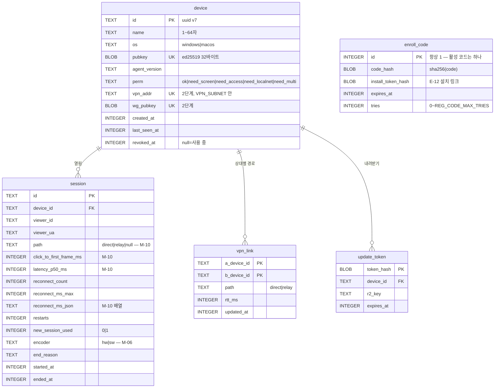

# API 계약 & 데이터 스키마 — WebDesktop
버전: v1.3 · 기준 03 v1.2 · 개정: DL-10(Worker 둘로 — app 은 Access, hub 는 공개 + 입장권) · GATE 1차 + 재검토(N1 설치 링크 로그인 없이, N2 계측 저장 칸, N3 오프라인 판정, N5 토큰 표, VPN 경로 저장)

근거 (진입 사전조사)
- 정량: DO SQLite 객체당 10GB(유료), SQL 문 100KB·바인드 100개 — https://developers.cloudflare.com/durable-objects/platform/limits (2026-11-23).
- 정성: DO 는 WebSocket 서버로 한 인스턴스에 수천 연결, 휴면 중 자동 응답 가능 — https://developers.cloudflare.com/durable-objects/best-practices/websockets ; workers-rs `set_websocket_auto_response`(v0.9.0 `worker/src/durable.rs`).
- 사용자 영향: 오류는 화면에 사람 말로(오류 이름 → 문구 표 하나, `web/src/errors.ts`).

## 규약
- 전송: HTTPS JSON + WebSocket(TLS) JSON. 메시지 정의는 `crates/proto` 한 곳 → `ts-rs` 로 TS 타입 생성(공유 계약).
- 오류 꼴: RFC 9457 Problem JSON `{type, title, status, detail}`. WebSocket 오류는 `{t:"error", type, detail}`. 스택은 내보내지 않는다.
- 오류 이름(`type`) 전체: `unauthorized`(401) · `not_found`(404) · `bad_request`(400, 꼴 검사 실패 — DL-12) · `code_invalid`(400) · `code_expired`(400) · `device_offline`(409) · `device_revoked`(403) · `bad_signature`(401) · `upgrade_required`(426) · `rate_limited`(429) · `too_large`(413) · `internal`(500).
- 세션 종료 사유(`session.end.reason`): `viewer_closed` · `host_closed` · `taken_over` · `host_shutdown` · `failed` · `device_revoked`.
- 판: WebSocket 첫 교환에 `proto` major. 다르면 `upgrade_required` 로 닫고 에이전트는 업데이트(FR-017).
- 페이지: 접속 기록은 커서(`before=<started_at>.<id>`).
- 뷰어 식별: 웹앱이 처음 열릴 때 무작위 `viewer_id`(uuid)를 만들어 localStorage 에 두고 `/api/ws` 첫 메시지와 `POST /api/sessions` 에 보낸다(모든 뷰어가 같은 Access 이메일이라 구분용).
- 멱등: `POST /api/sessions` — 같은 `viewer_id`·같은 기기의 열린 세션이 있으면 그 세션을 돌려준다. 다른 `viewer_id` 면 앞 세션을 `taken_over` 로 닫고 새로 만든다. `POST /agent/enroll` 은 코드 1회용이라 재시도는 `code_invalid`.
- 인증: `/`·`/assets/*`·`/api/*` = Cloudflare Access(Worker 가 `Cf-Access-Jwt-Assertion` 서명·aud 도 직접 검증). `/agent/*`·`/healthz` = Access 우회(03 가정 H2), `/agent/*` 는 기기 서명 또는 등록 코드 또는 설치 토큰 또는 업데이트 토큰.
- 꼴 검사: 입구에서 크기 ≤ WS_MSG_MAX_BYTES, 필드 길이 상한, enum 확인 → 통과한 타입만 서비스로.
- 빈도: IP·기기마다 RATE_LIMIT_PER_MIN.
- 유지 신호: 에이전트·뷰어는 AGENT_HEARTBEAT_SEC 마다 문자열 `ping` → DO 자동 응답 `pong`(휴면 중인 DO 를 깨우지 않음).

## 엔드포인트 표
| ID | 메서드 경로 | 요청(핵심 필드) | 응답 | 주요 오류 | 권한 |
|---|---|---|---|---|---|
| E-01 | GET `/` , `/assets/*` | — | 웹앱 정적 자산 | — | Access |
| E-02 | GET `/api/devices` | — | `[{id,name,os,online,last_seen_at,perm,connectable,offline_long,vpn_addr,vpn_links:[{peer_id,path,rtt_ms}]}]` | `unauthorized` | Access |
| E-03 | POST `/api/enroll-codes` | — | `{code, expires_at, install_links:{windows,macos}}` — 링크는 E-12 주소 + 1회 발급 토큰(INSTALL_LINK_TTL_MIN, 활성 코드와 같이 폐기). 이전 활성 코드·링크 폐기 | `rate_limited` | Access |
| E-04 | POST `/agent/enroll` | `{code, pubkey(ed25519 b64), name, os, agent_version}` | `{device_id}` | `code_invalid`, `code_expired`, `rate_limited`, `too_large` | 코드 |
| E-05 | GET `/agent/ws` (WebSocket) | 1) 허브→`{t:"hello", nonce, proto}` 2) 에이전트→`{t:"auth", device_id, sig=ed25519(nonce‖device_id), proto}` | 아래 WS 메시지 | `bad_signature`, `device_revoked`, `upgrade_required` | 기기 서명 |
| E-06 | GET `wss://webdesktop-hub…/ws/viewer?ticket=` (WebSocket, 허브 Worker) | E-13 입장권 + 첫 메시지 `{t:"viewer.hello", viewer_id, proto}` | 아래 WS 메시지 | `unauthorized`(입장권 없음·만료·사용됨) | 입장권 |
| E-13 | POST `/api/ws-ticket` (app Worker) | `{viewer_id}` | `{ticket, hub_ws_url, expires_at}` — 1회용, 60초 | `unauthorized` | Access |
| E-07 | POST `/api/sessions` | `{device_id, viewer_id}` | `{session_id, ice_servers:[stun, turn{urls,username,credential}]}` | `device_offline`, `device_revoked`, `not_found` | Access |
| E-08 | DELETE `/api/devices/{id}` | — | 204 | `not_found` | Access |
| E-09 | GET `/api/access-log?before=` | — | `{items:[{session_id,device_id,viewer_id,viewer_ua,path,click_to_first_frame_ms,latency_p50_ms,reconnect_count,reconnect_ms_max,reconnect_ms[],restarts,new_session_used,encoder,started_at,ended_at,end_reason}], next}` | — | Access |
| E-10 | GET `/agent/update/file?token=` | M-07 의 1회용 토큰(UPDATE_TOKEN_TTL_MIN) | R2 `webdesktop-releases` 의 파일 스트림 | `code_invalid`(토큰), `code_expired` | 토큰 |
| E-11 | GET `/healthz` | — | `{ok:true, proto}` | — | 공개 |
| E-12 | GET `/agent/install/{os}?t=` | E-03 의 설치 링크 토큰 | 설치 파일(R2) — 허브 주소는 빌드 때 들어 있음. 새 PC 에서 로그인 없이 받음(웹앱에서 링크를 복사하거나 QR 로 옮김). 토큰 수명 안에서 재시도 가능 | `code_invalid`, `code_expired`, `not_found` | 설치 토큰 |

WebSocket 메시지 (`t` 필드로 구분, 전부 `proto` 정의)
| ID | 방향 | t | 필드 | 쓰임 |
|---|---|---|---|---|
| M-01 | 허브→뷰어 | `device.status` | device_id, online, perm, connectable, last_seen_at, vpn_links | 목록 갱신(FR-003·009) |
| M-02 | 허브→에이전트 | `session.start` | session_id, ice_servers | 세션 준비(FR-004) |
| M-03 | 양방향 | `signal.offer` / `signal.answer` / `signal.candidate` / `signal.restart` | session_id, sdp / candidate | 신호 중계·ICE 재시작(FR-004·010) |
| M-04 | 양방향 | `session.end` | session_id, reason | 종료·이어받기(FR-004) |
| M-05 | 에이전트→허브 | `agent.report` | perm{screen,access,localnet}, monitors[{index,w,h}], version | 권한·모니터(FR-009·012) |
| M-06 | 에이전트→허브 | `session.host_stats` | session_id, encoder(hw/sw), avg_bitrate_kbps | 기록(FR-015) |
| M-07 | 허브→에이전트 | `update.available` | version, sha256, sig, token | 업데이트(FR-017) — 허브가 에이전트 연결 때 R2 `latest-{os}.json` 과 판을 비교해 보냄 |
| M-08 | 양방향 | `vpn.join` / `vpn.peer` / `vpn.candidates` / `vpn.peer_removed` | wg_pubkey, vpn_addr, ice_ufrag, ice_pwd, candidates[] | 2단계 VPN 상대 정보·ICE 교환(FR-018) |
| M-09 | 양방향 | 문자열 `ping` / `pong` | — | 유지 신호(DO 자동 응답) |
| M-10 | 뷰어→허브 | `session.viewer_stats` | session_id, click_to_first_frame_ms, latency_p50_ms, reconnect_ms[], restarts, new_session_used, path(뷰어가 본 선택 후보 쌍 — 경로의 유일한 출처) | 잼 수단 SC-002·003·005, 경로 표시(FR-004), 기록(FR-015) |
| M-11 | 에이전트→허브 / 허브→에이전트 | `turn.request` / `turn.creds` | purpose(vpn) / ice_servers, expires_at | 2단계 에이전트 TURN 자격 발급·갱신(만료 TURN_CRED_TTL_MIN 전에 재요청) — FR-018 |
| M-13 | 에이전트→허브 | `agent.alive` | — | 오프라인 판정 대체(04 — 자동 응답 시각 API 가 없을 때만, OFFLINE_DETECT_SEC 절반마다) |
| M-12 | 에이전트→허브 | `vpn.path` | peer_device_id, path(direct/relay), rtt_ms | `vpn_link` 저장 → E-02·M-01 로 목록 표시(FR-018) |

DataChannel 메시지 (뷰어↔도우미, JSON 글 `{t:…}` — DL-12, `proto` 정의)
| ID | 채널 | 종류 | 필드 | 쓰임 |
|---|---|---|---|---|
| D-01 | input | `mouse_move` / `mouse_button` / `wheel` | seq, x,y(0~1), button, dx,dy | FR-006·007 |
| D-02 | input | `key` | seq, hid_usage(USB HID), down | FR-006·007(특수키 막대) |
| D-03 | input | `text` | seq, 완성 문자열 | FR-007(한글) |
| D-04 | control | `clipboard` | text | FR-011 |
| D-05 | control | `monitor.select` / `quality.set` | index / auto·saver | FR-012·013 |
| D-06 | control | `host.state` | desktop(default/winlogon/loginwindow), perm | FR-008·009·014 |
| D-07 | input | `sas` | seq | FR-008 Ctrl+Alt+Del |
| D-08 | control | `input.applied` | seq, rtp_ts(입력 반영 뒤 첫 인코딩 프레임의 RTP 타임스탬프) | SC-003 측정 |

## OpenAPI 스케치
```yaml
openapi: 3.1.0
info: {title: webdesktop-hub, version: 1.1.0}
paths:
  /api/enroll-codes:
    post:
      responses:
        '201': {content: {application/json: {schema: {type: object, required: [code, expires_at],
          properties: {code: {type: string, pattern: '^[2-9A-HJ-NP-Z]{8}$'}, expires_at: {type: string, format: date-time}}}}}}
        '429': {$ref: '#/components/responses/Problem'}
  /agent/enroll:
    post:
      requestBody: {content: {application/json: {schema: {type: object, required: [code, pubkey, name, os, agent_version],
        properties: {code: {type: string, maxLength: 8}, pubkey: {type: string, maxLength: 64}, name: {type: string, maxLength: 64},
                     os: {enum: [windows, macos]}, agent_version: {type: string, maxLength: 32}}}}}}
      responses:
        '201': {content: {application/json: {schema: {type: object, properties: {device_id: {type: string}}}}}}
        '400': {$ref: '#/components/responses/Problem'}
  /api/sessions:
    post:
      requestBody: {content: {application/json: {schema: {type: object, required: [device_id, viewer_id],
        properties: {device_id: {type: string}, viewer_id: {type: string, format: uuid}}}}}}
      responses:
        '201': {content: {application/json: {schema: {type: object, properties: {session_id: {type: string}, ice_servers: {type: array}}}}}}
        '409': {$ref: '#/components/responses/Problem'}
components:
  responses:
    Problem: {content: {application/problem+json: {schema: {type: object, properties: {type: {type: string}, title: {type: string}, status: {type: integer}, detail: {type: string}}}}}}
```

## ERD

- 소프트 삭제: `device.revoked_at`(기록 보존). 나머지는 실제 삭제.
- 에이전트 판 정보는 DB 가 아니라 R2 `webdesktop-releases/latest-{os}.json`(서명 포함) — 배포 명령이 파일과 함께 올린다(관리 API 없음).

## 저장소 설계
- 마이그레이션: `crates/hub/migrations/NNNN_이름.sql`, 적용한 파일은 고치지 않음. DO 생성자에서 `schema_version` 표를 보고 순서대로 적용(DO 단일 스레드 — 동시 적용 잠금 불필요). 마이그레이션 시험: 두 번째 실행은 적용 0.
- 쿼리 경로 → 색인 대조표

| 쿼리 (기능) | WHERE·ORDER | 색인 |
|---|---|---|
| 기기 목록 (E-02) | `revoked_at IS NULL` ORDER BY name | 전체 스캔(행 수십, 1인 — 색인 불필요) |
| 서명 확인 (E-05) | `id = ?` | 기본 키 |
| 등록 (E-04) | `id = 1` | 기본 키 |
| 공개키 중복 (E-04) | `pubkey = ?` | 유일 색인 |
| 세션 이어받기 (E-07) | `device_id = ? AND ended_at IS NULL` | `idx_session_open (device_id, ended_at)` |
| 접속 기록 (E-09) | ORDER BY started_at DESC, id DESC, 커서 | `idx_session_started (started_at, id)` |
| 기록 정리 | `started_at < ?` | `idx_session_started` |
| VPN 상대 목록 (M-08) | `vpn_addr IS NOT NULL AND revoked_at IS NULL` | 전체 스캔(행 수십) |
| VPN 경로 (E-02, M-12) | `a_device_id = ? OR b_device_id = ?` | 기본 키 + 행 수십 |
| 설치 링크 (E-12) | `id = 1` 후 install_token_hash 대조 | 기본 키 |
| 업데이트 토큰 (E-10) | `token_hash = ?` | 기본 키 |
| 토큰 정리 | `expires_at < ?` | 전체 스캔(행 몇 개) |

- 제약: `os` CHECK(windows|macos), `perm` CHECK, `path` CHECK, `enroll_code.id` CHECK(id=1), `tries` CHECK(0~REG_CODE_MAX_TRIES), `session.device_id` 외래 키, `pubkey`·`vpn_addr`·`wg_pubkey` 유일.
- 트랜잭션(`transactionSync`):
  - 코드 만들기 = {기존 행 삭제 + 새 행}.
  - 등록 = {행 읽기 → 만료면 삭제·`code_expired` / 해시 다르면 tries+1(상한이면 행 삭제)·`code_invalid` / 같으면 행 삭제 + 기기 생성}.
  - 기기 제거 = {revoked_at 설정 + 열린 세션 `device_revoked` 종료}.
  - 동시 수정: DO 단일 스레드라 없음.
- 연결 풀: 해당 없음(DO 내장 SQLite, 원격 연결 없음).
- 만료 정리: DO 알람 하루 1회 — 만료 코드 행·업데이트 토큰 삭제, ACCESS_LOG_DAYS 지난 세션 삭제. 업데이트 토큰은 사용 즉시 삭제(1회용).
- 오프라인 판정: `device.last_seen_at` = 마지막 앱 메시지·연결·(가능하면) 자동 응답 시각. 뷰어가 E-02 를 부르거나 세션을 열 때 OFFLINE_DETECT_SEC 넘은 기기는 offline 으로 바꾸고 그 WebSocket 을 닫는다.
- 백업: DO SQLite 시점 복구 PITR_DAYS(07).

## 데이터 규칙
- 시각: 저장 = UTC 밀리초 정수, 전송 = ISO8601. 식별자: uuid v7. 금액 없음.
- 보존: 세션 기록 ACCESS_LOG_DAYS, 등록 코드는 사용·만료·폐기 즉시 삭제, 기기 행은 사용자가 지울 때까지.
- 화면·입력·클립보드 내용은 저장하지 않는다.

## 커버리지 매핑
| FR-ID | 담당 엔드포인트/이벤트 |
|---|---|
| FR-001 | E-01, E-06, 모든 `/api/*` Access JWT 검증 |
| FR-002 | E-03, E-12(로그인 없는 설치 링크), E-04, E-05 |
| FR-003 | E-02, M-01, M-13(대체) |
| FR-004 | E-07, M-02, M-03, M-04, M-10(경로) |
| FR-005 | 영상 트랙(WebRTC, str0m H.264 프레임 쓰기), M-06 |
| FR-006 | D-01, D-02 |
| FR-007 | D-01, D-02, D-03 |
| FR-008 | D-07, D-06 |
| FR-009 | M-05, M-01, D-06 |
| FR-010 | M-03(`signal.restart`), E-07(새 세션 1회), M-10 |
| FR-011 | D-04 |
| FR-012 | M-05, D-05 |
| FR-013 | D-05 |
| FR-014 | D-06 |
| FR-015 | M-06, M-10, E-09 |
| FR-016 | E-08 |
| FR-017 | M-07, E-10 |
| FR-018 | M-08, M-11, M-12, E-02 `vpn_links` |
